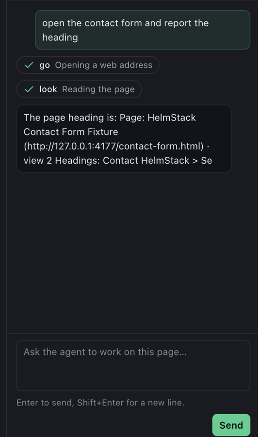

# HelmStack

[](https://github.com/mondb-dev/helmstack/actions/workflows/ci.yml)
[](./LICENSE)

**A browser you share with your AI agent.** The agent can see, test and debug the front-end you are building, and run the browser chores you hand it, while every decision that matters stays with you.

HelmStack turns a live page into structured data (what is on it, what changed, what is broken) and into tools an agent calls over MCP or HTTP. One shared core runs in two places: an Electron desktop browser you can watch and steer, and a headless Chrome daemon for CI.

## Why HelmStack

- **Your coding agent verifies its own UI work.** Screenshot baselines with pixel diffs, a "what changed" map of the page, accessibility (WCAG), SEO, layout, focus-order and performance audits, unused CSS and JS, network mocks and style assertions, all in one MCP server. The same tools answer in the window you watch and in CI.
- **You stay in charge.** Sensitive actions wait for the person at the window: an agent that tries to approve its own gets `403 requires_human`. Approvals are tied to the page they were asked on and expire after 10 minutes. The API listens on loopback only and needs a token.
- **Routines: chores in plain words, run under your rules.** Ask "watch this page for news on X and note anything new" or "keep my roster's lineup set each day". The agent writes it as a reviewable JSON procedure from a closed set of steps, and you approve it after reading a plain-language preview with its risks. Judgment calls go to a model you choose, which has no tools and must quote the page to back its answer. Actions run on their own only within limits you set (what kinds of change, how many per day, names it must never remove), offers to other people always wait for your tap, and every action is checked on the page afterwards. A kill switch stops everything.
- **Findings you can tell apart from facts.** Page analysis reports keep what HelmStack measured separate from what the agent concluded, in a self-contained HTML or Markdown file.
- **Works with the model you already use.** Install into Claude Code, Codex, Gemini CLI, Cursor, Claude Desktop or Antigravity from the window, chat with an agent or a local model in the side panel, and give small local models (Ollama, LM Studio) a 14-verb lite toolset they can manage.

## Status

Pre-release. The `@helmstack/*` npm packages have not been published yet (the release workflow is blocked on the `NPM_TOKEN` repository secret), so everything below runs from a clone. See [Known limitations](#known-limitations).

## Quickstart

Requirements: Node 20 or newer, npm 10 or newer. The daemon also needs a Chrome or Chromium.

```bash
git clone https://github.com/mondb-dev/helmstack.git
cd helmstack
npm install
```

### 1. Desktop app

```bash
npm run dev
```

The window opens with a browser and an agent panel. The status chip at the top right shows the agent API port (7070 by default). Click it, then **Connect agents…** to install HelmStack's MCP server into Claude Code, Claude Desktop, Gemini CLI, Codex CLI, Antigravity or Cursor. See [Getting started](docs/getting-started.md).

### 2. Headless daemon (CI)

```bash
npm run build:packages
npm run build -w @helmstack/daemon
HELMSTACK_AUTH_TOKEN=local-dev-token node apps/daemon/dist/main.js --port 7195
curl -H "X-HelmStack-Token: local-dev-token" http://127.0.0.1:7195/api/health
```

Expected response: `{"status":"ok","connectedAgents":0,"tabs":1,"backend":"daemon","capabilities":[]}`. See [Headless and CI](docs/headless-ci.md).

### 3. MCP client

Add the server to any client that takes an `mcpServers` config, pointing at the port and token file of a running desktop app or daemon:

```json
{
  "mcpServers": {
    "helmstack": {
      "command": "node",
      "args": ["/path/to/helmstack/packages/mcp-server/dist/index.js"],
      "env": { "HELMSTACK_PORT": "7070", "HELMSTACK_TOKEN_FILE": "/path/to/helmstack-agent-token" }
    }
  }
}
```

Run `npm run build:packages` first so `dist/index.js` exists. The desktop app's **Connect agents** dialog writes this for you. See [Connect an agent](docs/connect-an-agent.md).

## What it can do

| Area | Examples |
| --- | --- |
| See the page | Perception graph, accessibility tree, per-element bounds, framework and component detection, element picks from a human |
| Compare | Named screenshots and pixel diffs, perception diffs, multi-viewport suites, "what changed" element mapping |
| Audit | Accessibility (WCAG), SEO, focus order, layout issues, performance, unused CSS and JS, design tokens |
| Assert | Computed-style assertions, natural-language assertions, standing watches |
| Control the environment | Viewport, media emulation, geolocation, network mocks, resource budgets, cookies, storage |
| Record | Console and network logs, HAR export, traces, command recordings |
| Report | Page analysis reports with measured evidence and the agent's findings kept apart ([Reports](docs/reports.md)) |
| Routines | Watch, judge and act on a schedule you approve, with memory, notes, a reference library and per-action limits ([Routines](docs/routines.md)) |
| Chat | Talk to Claude Code, Gemini CLI or a local model in the window; every tool call shows as a chip ([Agent chat](docs/agent-chat.md)) |

The complete list is generated from source: [MCP tools](docs/mcp-tools.md) and [HTTP API](docs/http-api.md).



## When another tool fits better

- **You only need to give a coding agent a browser and DevTools.** Google's [Chrome DevTools MCP](https://github.com/ChromeDevTools/chrome-devtools-mcp) is mature, officially maintained and covers tracing, Lighthouse, heap snapshots and input automation. HelmStack adds baselines and diffs, coverage, network mocks, assertions, human-only approvals and routines on top of a similar base.
- **You want scripted test automation or test generation.** [Playwright](https://playwright.dev/) and its MCP server are the standard.
- **You want an assistant for everyday browsing in your own browser.** Browser assistants such as Claude in Chrome are simpler to set up for one-off and scheduled chores. Choose HelmStack when you want the procedure written down, reviewed and limited before it runs.

## Safety model in brief

- The API listens on `127.0.0.1` only and needs a token.
- On the desktop app, only the person at the window can approve a queued sensitive action. An agent that tries gets `403` with `code: "requires_human"`.
- Approvals are tied to the page they were requested on and expire after 10 minutes.
- In-window chat is confined to HelmStack's own tools.
- Routines run only after you approve them. Their judgment model has no tools, their actions ask you unless you allowed that kind of change, and offers to other people, purchases, sign-ups and similar always ask.

Details: [Security model](docs/security-model.md), [Approvals](docs/approvals.md).

## Known limitations

- **Pre-release.** npm packages are not published yet; run from a clone.
- **Routines are new.** They have been exercised on local test pages and against real models (Claude, a local Llama 3.2 3B), not yet on real third-party sites. Finding a list or a control on a page is site-agnostic and may miss on complex single-page apps. `schedule` (cron) and `event` triggers are accepted but do not run yet. The daemon runs routines that are already approved but has no window to approve them.
- **Small local models are limited.** The local-model loop and lite toolset were checked live with Llama 3.2 3B on a few tasks; small models still guess or give up on longer ones, and answer more judgments as "uncertain".
- **Windows.** The test suite passes on Windows, but the desktop app has not been tried there by a person. In-window chat with agent CLIs and CLI models for routines are not supported on Windows; use a local model.
- **Partly verified integrations.** The Gemini CLI path could not be signed in during testing and is marked experimental. Install paths for Codex, Cursor, Claude Desktop and Antigravity follow their documentation and were not tested against the real apps; Claude Code and Gemini CLI were exercised against real binaries.
- ChatGPT cannot use a local stdio MCP server.

## Documentation

Start at the [documentation index](docs/README.md). Contributors: [CONTRIBUTING.md](CONTRIBUTING.md).

## Repository layout

| Path | What it is |
| --- | --- |
| `packages/devtools-core` | `HelmstackCore` (every tool, implemented once over a CDP target), the HTTP+SSE agent server, stores, approvals, the chat runner |
| `apps/desktop` | Electron shell: tabs, side panel, approvals UI, Connect an agent dialog |
| `apps/daemon` | `helmstack-daemon`: the same API on a headless Chrome |
| `packages/mcp-server` | `helmstack-mcp`: MCP tools over the agent API |
| `packages/agent-sdk` | TypeScript HTTP client and the lite toolset |
| `packages/perception` | In-page extractor that builds the perception graph |
| `packages/shared` | Types, shortcut table, CDP target contract |
| `apps/agent-example` | Example agents: an intent-driven one and LLM-backed variants (not published) |

## License

MIT. See [LICENSE](LICENSE).
